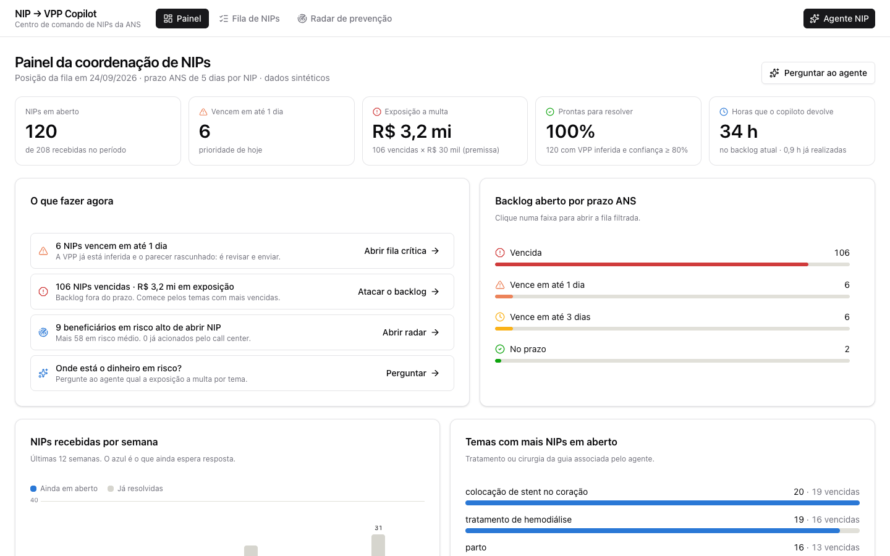
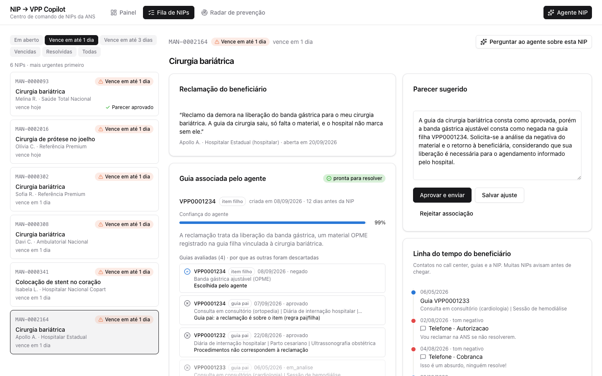
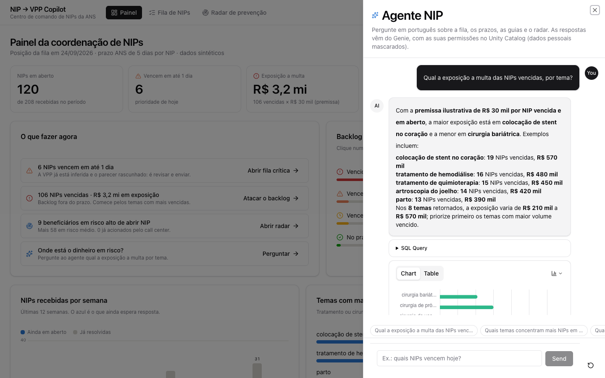
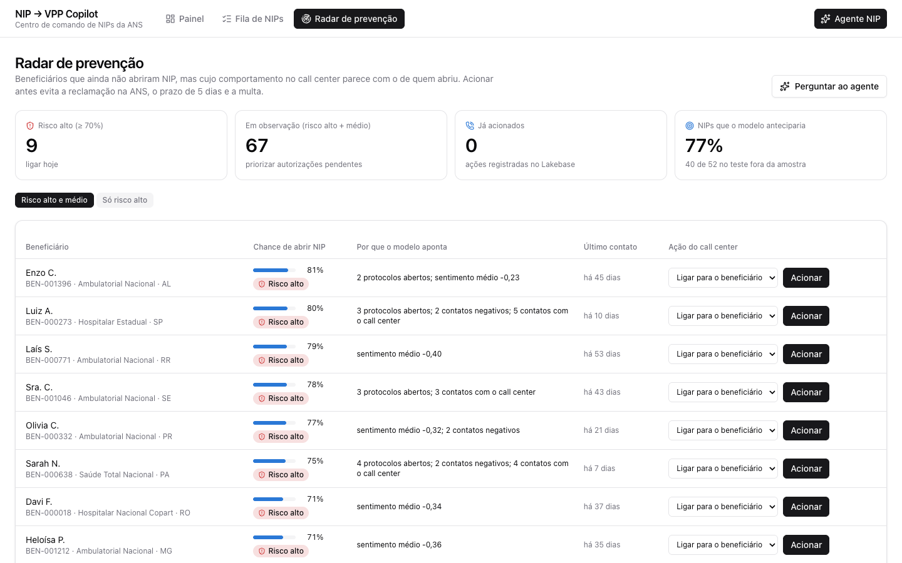

# NIP → VPP Copilot
### Cortando multas da ANS e o tempo de análise nas NIPs de saúde suplementar

*Solução de IA de ponta a ponta na Databricks · caso inspirado em uma operadora de saúde real · **dados 100% sintéticos***

---

## O problema de negócio

Quando um beneficiário abre uma **NIP** (Notificação de Intermediação Preliminar) na **ANS**, a operadora tem **5 dias** para responder — ou paga **multa**.

Para responder, o analista precisa encontrar, entre dezenas de guias de autorização prévia (**VPP**) do beneficiário, **a guia certa** que fundamenta a negativa — e então redigir o parecer, **à mão**.

> É um trabalho manual, repetitivo e sob relógio regulatório. Sob pico de volume, o prazo estoura e a multa vem.

---

## O custo hoje

- **Tempo por NIP:** ~25 min só para caçar a VPP e escrever o parecer.
- **Retrabalho:** 3 analistas podem abrir a mesma NIP e repetir a busca.
- **Backlog vencido:** NIPs fora do prazo de 5 dias = **exposição direta a multa** (dezenas de milhares de R$ por infração).
- **Escala:** o volume de NIPs cresce com a insatisfação no call center — sem alavanca, a operação só corre atrás.

---

## A solução

No instante em que a NIP chega, o copiloto:

1. **Infere a VPP correta** aplicando as regras do negócio (pai vs. filha, janela de 65 dias, casos já resolvidos).
2. **Rascunha o parecer** consultando o rol de procedimentos da ANS e a cobertura do plano.
3. **Entrega tudo no fluxo do analista**, com um **score de confiança** e o porquê de cada decisão.
4. Quando a confiança é alta, o caso pode ser **fechado sem intervenção humana**.

E o mesmo app dá à coordenação quatro movimentos:

| Enxergar | Perguntar | Resolver | Prevenir |
|---|---|---|---|
| **Painel**: backlog por prazo, exposição a multa em R$, temas críticos | **Agente NIP**: perguntas em português, respondidas com dado governado | **Fila**: VPP inferida, guias descartadas e o motivo, checagem no rol, parecer pronto | **Radar**: quem vai abrir NIP antes de abrir, e o call center aciona |

---

## O que isso gera (KPIs do comprador)

| KPI | Hoje | Com o copiloto |
|---|---|---|
| Tempo médio por NIP | ~25 min | **~8 min** |
| NIPs no prazo de 5 dias | em risco nos picos | **triagem por SLA + inferência automática** |
| Retrabalho | 3× a mesma NIP | inferida **1×** e reaproveitada |
| Resoluções automáticas | 0% | **alta confiança → fecha sozinho** |

**Impacto ilustrativo:** para ~2.000 NIPs/mês, reduzir de ~25 → ~8 min libera **~560 horas de analista/mês**; cada prazo salvo remove uma exposição a multa da ANS.

---

## O que o time vê

**Painel da coordenação**: 120 NIPs em aberto, R$ 3,2 mi de exposição (premissa editável), o que fazer agora.

**Fila**: a NIP sobre a banda gástrica, a guia escolhida com 99% de confiança e as guias descartadas pela regra pai/filha, por procedimento diferente e pela janela de 65 dias.

**Agente NIP**: "qual a exposição a multa por tema?" respondido com os dados, o gráfico e o SQL.

**Radar de prevenção**: beneficiários que ainda não abriram NIP, mas cujo comportamento no call center aponta que vão abrir.

---

## Provas do protótipo (dados sintéticos, mas executado de verdade)

- **96,6%** de acerto na associação NIP→VPP em **208 NIPs** (contra o gabarito), forte em todos os casos difíceis.
- **Confiança média 98,8%**; **120 de 120** NIPs abertas classificadas como auto-resolvíveis no corte de confiança.
- Modelo de **propensão a abrir NIP** com **ROC-AUC 0,926**: identificaria **77% das NIPs** (40 de 52 no teste fora da amostra). Hoje aponta **9 beneficiários em risco alto e 67 em observação**.
- Backlog atual: **106 NIPs vencidas = R$ 3,2 mi de exposição** (premissa ilustrativa de R$ 30 mil por NIP).
- Governança de PII (LGPD) aplicada e **preservada em todas as camadas** (inclusive no app e no Genie).

---

## Como funciona (uma olhada na arquitetura)

**Lakeflow** ingere as manifestações → **Unity Catalog** governa (masking de PII, linhagem) → **Agente de IA + ML** inferem VPP, redigem parecer e pontuam a propensão → **Lakebase** serve a fila e o radar em baixa latência e recebe as decisões do analista → **Genie** responde perguntas em nome de quem pergunta → **App Databricks** junta tudo no centro de comando.

> Uma jornada integrada, não peças soltas. O dado flui do bruto ao parecer sem sair da plataforma.

---

## Valor para cada stakeholder

**Patrocinador executivo (custo e risco)**
- Menos multas da ANS; mais NIPs no prazo.
- Mais vazão por analista sem aumentar headcount.
- Automação gradual e auditável (o negócio controla o corte de confiança).

**Dono do domínio (qualidade e operação)**
- Regras do negócio embutidas (pai/filha, janela, casos resolvidos).
- Parecer rascunhado e rastreável; decisão do analista registrada (write-back).
- PII mascarada e linhagem completa — conforme a LGPD.

---

## Por que Databricks

- **Uma plataforma** do dado cru ao app — sem costurar ferramentas (a POC atual vive presa no ecossistema Google/BQ).
- **Conector nativo e bidirecional com Salesforce** — onde o analista já trabalha.
- **Genie / Databricks One** — consulta conversacional sem expor a complexidade.
- **Unity Catalog** — governança, masking e **linhagem** ponta a ponta para dado de saúde regulado.

---

## Roadmap

1. **Entregue no protótipo:** painel, fila com VPP inferida e parecer, radar de prevenção e agente Genie.
2. Piloto de 4 semanas com um grupo de analistas: medir tempo por NIP e NIPs dentro do prazo.
3. Automação do parecer com **no-human-in-the-loop** acima do corte de confiança.
4. Escrita direta no **Salesforce** via conector nativo, onde o analista já trabalha.
5. **Reembolso:** análise de documentos e imagens com LLM.

---

## Próximos passos

- Rodar o piloto com um subconjunto de analistas e medir tempo/prazo/vazão reais.
- Calibrar o corte de confiança com o negócio para liberar automação.
- Conectar às tabelas de produção (discovery de dados com o time de engenharia).

**A pergunta não é *se* dá para automatizar — o protótipo mostra que dá. É *quão rápido* a operação quer capturar o valor.**
